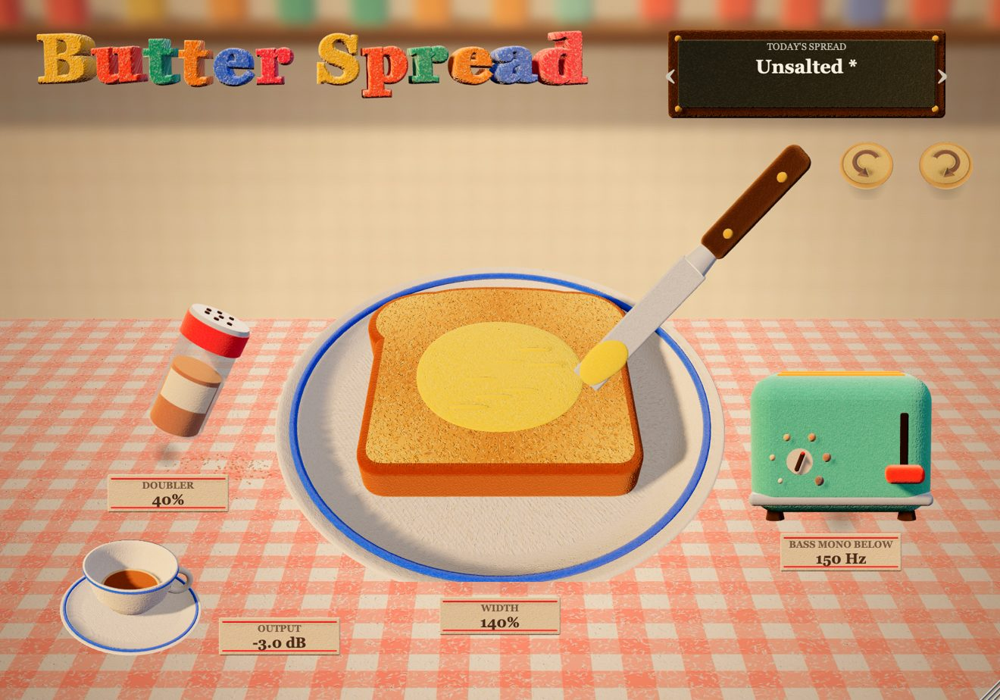

# Butter Spread

A free stereo widener from **Plugins for Breakfast**, for macOS (AU + VST3).
Every control is a needle-felt object on a breakfast table.



| Object | Control |
| --- | --- |
| Knife spreading butter on the toast | **Width**, 0% (mono) to 200% |
| Cinnamon shaker | **Doubler**: widens mono sounds and cancels completely when summed to mono |
| Toaster lever | **Bass mono** on/off |
| Toaster dial | **Mono below** 40 to 400 Hz |
| Teacup | **Output** -12 to +12 dB |
| Shortbread biscuits | **Undo / Redo** (also Cmd+Z / Cmd+Shift+Z) |
| Menu board | Presets, including saving your own |

Double-click a control to reset it; hold Shift while dragging for fine steps.

## Download

Get the Mac installer from [Releases](../../releases). It is unsigned, so right-click it and choose Open the first time.

## How it works

The signal is split with a Linkwitz-Riley crossover. Below the crossover, left and right blend towards mono.
Above it, the side signal is scaled by Width; the Doubler adds an 11 ms delayed, high-passed copy of the mid
to the sides only, so it never changes the mono sum. See `Source/PluginProcessor.cpp`.

## Building

Needs CMake 3.22+, Xcode command line tools and Ninja.

```sh
git clone --recursive https://github.com/sarthakzzz/butter-spread.git
cd butter-spread
cmake -B build -G Ninja -DCMAKE_BUILD_TYPE=Release
cmake --build build --target ButterSpread_AU ButterSpread_VST3
```

The plug-ins are copied to `~/Library/Audio/Plug-Ins` after building. `installer/build-mac.sh` makes the `.pkg`.
The art is rendered with the three.js scene in `design/` (see `design/README.md`).

## Licence

Butter Spread is released under the GNU Affero General Public License v3.0 (see `LICENSE`).
It is built with [JUCE](https://juce.com), used under its AGPLv3 licence.
